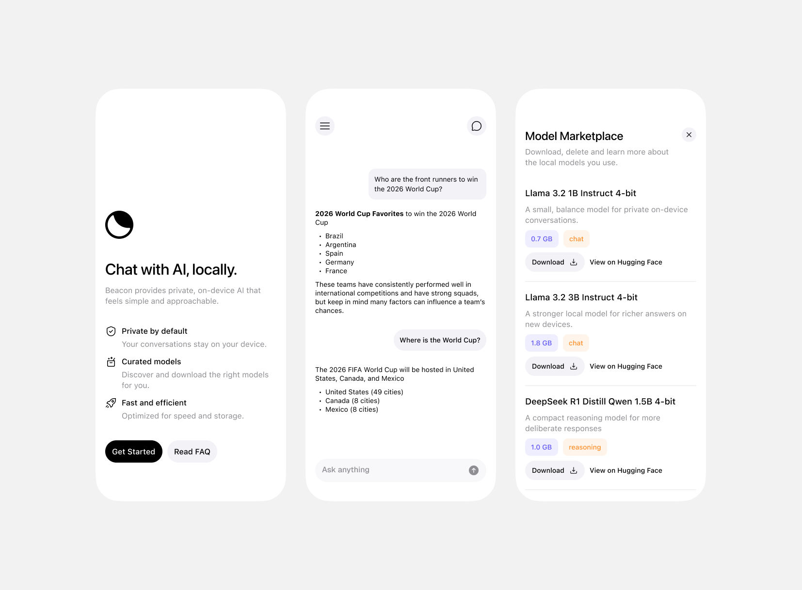

# Beacon

Beacon is a private, local-first AI assistant for Apple devices. It downloads and runs MLX language models on-device, so everyday chats and inference stay on your device.

The project explores what a polished, approachable interface for local AI can look like. Beacon supports different model families and capabilities so people can choose the model that best fits their device and task.



## Features

- Private on-device chat with local MLX models
- A curated marketplace of iPhone-suitable Hugging Face MLX models
- Persisted conversations with history selection and swipe-to-delete
- Streaming Markdown responses, including code blocks and inline formatting, with a stop button
- Shortcuts/App Intents support for asking the selected model

## Included Models

The bundled catalog contains **50 text and vision models** whose architectures and image processors are supported by the pinned MLX Swift LM runtime. Most are 4-bit conversions; the original SmolVLM2 option uses full-precision weights. Download sizes are approximate and exclude runtime memory required during generation. Hub/configuration auditing does not replace iPhone inference testing.

The original 15 entries are listed below. The full catalog is in [`beacon/Resources/models.json`](beacon/Resources/models.json); see the [expansion notes](research_notes/2026-10-17-mlx-catalog-audit.md) and [per-repository audit](reports/model-catalog-audit.json) for the additional 35 entries and verification scope. Device names in this historical table are guidance, not download restrictions; the app uses RAM estimates.

| Company | Model | Hugging Face repository | Download | Recommended device |
| --- | --- | --- | ---: | --- |
| Liquid AI | LFM2 1.2B | [`mlx-community/LFM2-1.2B-4bit`](https://huggingface.co/mlx-community/LFM2-1.2B-4bit) | 0.66 GB | iPhone 14+ |
| Liquid AI | LFM2.5 1.2B Instruct | [`mlx-community/LFM2.5-1.2B-Instruct-4bit`](https://huggingface.co/mlx-community/LFM2.5-1.2B-Instruct-4bit) | 0.66 GB | iPhone 14+ |
| Alibaba | Qwen3 0.6B | [`mlx-community/Qwen3-0.6B-4bit`](https://huggingface.co/mlx-community/Qwen3-0.6B-4bit) | 0.35 GB | iPhone 14+ |
| Alibaba | Qwen3 1.7B | [`mlx-community/Qwen3-1.7B-4bit`](https://huggingface.co/mlx-community/Qwen3-1.7B-4bit) | 0.98 GB | iPhone 14+ |
| Alibaba | Qwen3 4B Instruct 2507 | [`mlx-community/Qwen3-4B-Instruct-2507-4bit`](https://huggingface.co/mlx-community/Qwen3-4B-Instruct-2507-4bit) | 2.28 GB | iPhone 15 Pro+ |
| Alibaba | Qwen2.5 Coder 3B Instruct | [`mlx-community/Qwen2.5-Coder-3B-Instruct-4bit`](https://huggingface.co/mlx-community/Qwen2.5-Coder-3B-Instruct-4bit) | 1.75 GB | iPhone 15 Pro+ |
| Google | Gemma 3 1B Instruct | [`mlx-community/gemma-3-1b-it-qat-4bit`](https://huggingface.co/mlx-community/gemma-3-1b-it-qat-4bit) | 0.77 GB | iPhone 14+ |
| Meta | Llama 3.2 1B Instruct | [`mlx-community/Llama-3.2-1B-Instruct-4bit`](https://huggingface.co/mlx-community/Llama-3.2-1B-Instruct-4bit) | 0.71 GB | iPhone 14+ |
| Hugging Face | SmolLM3 3B | [`mlx-community/SmolLM3-3B-4bit`](https://huggingface.co/mlx-community/SmolLM3-3B-4bit) | 1.75 GB | iPhone 15 Pro+ |
| OpenBMB | MiniCPM5 2B | [`mlx-community/MiniCPM5-2B-mlx-4Bit`](https://huggingface.co/mlx-community/MiniCPM5-2B-mlx-4Bit) | 1.43 GB | iPhone 15 Pro+ |
| IBM | Granite 3.3 2B Instruct | [`mlx-community/granite-3.3-2b-instruct-4bit`](https://huggingface.co/mlx-community/granite-3.3-2b-instruct-4bit) | 1.43 GB | iPhone 15 Pro+ |
| DeepSeek | R1 Distill Qwen 1.5B | [`mlx-community/DeepSeek-R1-Distill-Qwen-1.5B-4bit`](https://huggingface.co/mlx-community/DeepSeek-R1-Distill-Qwen-1.5B-4bit) | 1.01 GB | iPhone 15 Pro+ |
| Microsoft | Phi 3.5 Mini Instruct | [`mlx-community/Phi-3.5-mini-instruct-4bit`](https://huggingface.co/mlx-community/Phi-3.5-mini-instruct-4bit) | 2.15 GB | iPhone 15 Pro+ |
| Hugging Face | SmolVLM2 500M (vision) | [`HuggingFaceTB/SmolVLM2-500M-Video-Instruct-mlx`](https://huggingface.co/HuggingFaceTB/SmolVLM2-500M-Video-Instruct-mlx) | 1.02 GB | iPhone 14+ |
| Alibaba | Qwen2-VL 2B (vision) | [`mlx-community/Qwen2-VL-2B-Instruct-4bit`](https://huggingface.co/mlx-community/Qwen2-VL-2B-Instruct-4bit) | 1.26 GB | iPhone 15 Pro+ |

Onboarding offers Chat Core, a bundle of models selected using the device's physical RAM rather than its iPhone generation. It chooses a lightweight chat model, the largest recommended Qwen chat variant, and a vision model when memory permits, without duplicate downloads. Models run one at a time. The same bundle is available in the Model Marketplace in Settings.

The marketplace exposes all 50 catalog models in company tabs, with live Hugging Face metadata fetched for the selected tab. The bundled catalog remains browsable offline; pull to refresh retries Hub information. RAM recommendations estimate weights plus inference overhead while reserving half of physical RAM for the system and app. They are advisory, not a guarantee: larger models remain downloadable with a memory warning. Free device storage and Beacon's 10 GB model-storage limit are still checked, including the combined space needed for a bundle. Models are downloaded from Hugging Face and stored in the app cache. Arbitrary Hub repositories and local GGUF imports are not supported by this MLX catalog.

The chat input's model switcher offers **Chat Core** for automatic routing or any downloaded, available model for manual use. The choice persists across launches and also applies to Shortcuts. Manual text models still use the vision bridge for image attachments. The switcher includes a shortcut to the marketplace for additional downloads.

The marketplace starts with **Chat Core** and **Recommended models** tabs, followed by company tabs. Recommended models includes only good RAM fits; company tabs retain every catalog option, including models with memory warnings. There is no search bar.

## Architecture

- `BeaconModelRuntime` loads MLX models from a Hugging Face repository and streams responses
- `Resources/models.json` defines the bundled marketplace catalog
- `WebSearchMCPClient` implements the optional MCP-compatible web-search integration
- `RequestLLMIntent` exposes a Shortcuts action for asking the selected model

## Requirements

- Xcode with the iOS SDK
- An iPhone supported by the selected model for on-device inference

## Development

Open `beacon.xcodeproj` in Xcode, select your signing team and bundle identifier, then build the `beacon` scheme.

Add or update compatible models by editing `beacon/Resources/models.json`. Each downloadable entry must be a 4-bit Hugging Face MLX repository whose `model_type` is supported by the pinned `MLX Swift LM` package. Model cards should use accurate repository IDs, download sizes, and device guidance.

### Run On Your iPhone

1. Clone the repository:

   ```sh
   git clone https://github.com/armondschneider/beacon.git
   cd beacon
   ```

2. Open `beacon.xcodeproj` in Xcode and wait for Swift Package dependencies to resolve.
3. In the target's **Signing & Capabilities** settings, select your Apple Developer team and choose a unique bundle identifier.
4. Connect and unlock your iPhone, select it as the run destination, then press Run.
5. Download a model from the marketplace, then select it before starting a chat.

### Optional Backend Setup

Beacon does not require a backend for local chat. The anonymous model-download counter is an optional service that each developer can host for their own build.

The repository also includes a grounded web-search integration, but it is currently disabled in `ChatView` for this release. Before enabling it in a build, deploy the service below and provide its endpoint. Beacon sends only the resolved search query; returned sources are rendered as numbered citations and tappable inline source cards.

The repository includes a Cloudflare Worker in `server/web-search-mcp` that provides both the web search MCP endpoint and model download analytics. To run your own instance:

1. Create a Cloudflare account and install Node.js.
2. From `server/web-search-mcp`, run `npm install` and `npx wrangler login`.
3. Deploy with `npm run deploy`.
4. Add the deployed URL to your local `beacon/Resources/LocalConfiguration.plist`:

   ```xml
   <key>WebSearchMCPURL</key>
   <string>https://your-worker.workers.dev/mcp</string>
   <key>ModelDownloadsURL</key>
   <string>https://your-worker.workers.dev/model-downloads</string>
   ```

These local configuration files are intentionally ignored by Git. A fresh clone keeps web search and analytics disabled until you provide your own endpoints. The model download counter records at most one download per anonymous app installation and does not collect names, accounts, or device identifiers.

## Contributing

Contributions are welcome. If you find a bug, have a feature request, or want to propose a larger change, open a GitHub issue so it can be discussed and tracked.

To submit a pull request:

1. Fork the repository and create a focused branch.
2. Make the smallest change that fully addresses the issue.
3. Build the app and run the relevant tests.
4. Use [Conventional Commits](https://www.conventionalcommits.org/) for commit messages.
5. Open a pull request that explains the problem, the solution, and how it was tested.

Common commit prefixes include:

```text
feat: add a model selector to the chat composer
fix: prevent duplicate chat submissions
docs: clarify local development setup
test: cover reasoning output filtering
chore: update project dependencies
```

Keep pull requests focused on one concern. Link the relevant issue when one exists, and include screenshots or recordings for visible UI changes.

## Security

Report vulnerabilities privately as described in [SECURITY.md](SECURITY.md).

## License

Beacon is available under the [MIT License](LICENSE).
